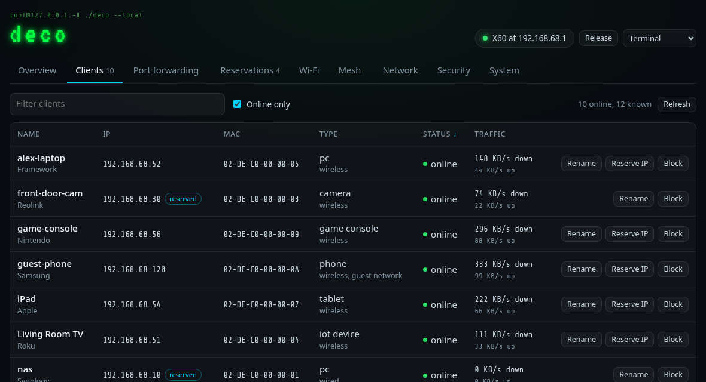
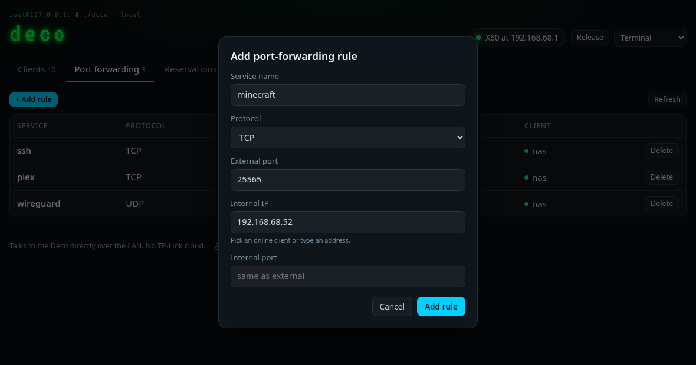
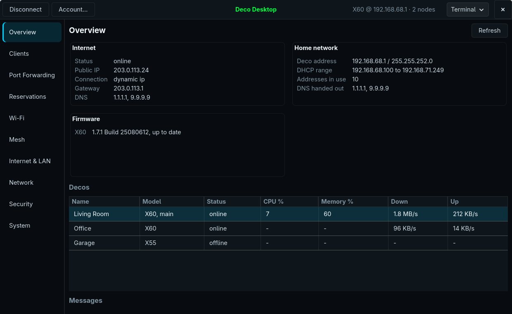

# deco-local

Manage a TP-Link Deco mesh from a browser or a Linux desktop, over your own network, without the phone app or the TP-Link cloud.

deco-local talks to the main Deco directly on your LAN. It focuses on the jobs that are hardest to do on a phone:

- **Port forwarding:** list, add, and delete rules, with a picker for the internal address.
- **Address reservations:** reserve a client's address from the client list, and edit or remove reservations.
- **Clients:** every client the mesh knows, with search, sorting, and renaming.
- **Mesh:** each Deco node with its backhaul, signal, and firmware.

It comes in three forms that share one backend: a web UI, a REST API with Swagger docs, and a GTK 4 desktop app.



## Run the web UI in a container

The container is the recommended way to run deco-local. It serves the web UI and the REST API on port 8777.

Before you start, you need the following:

- A Linux machine on the same LAN as your Deco. The container uses host networking because it finds the Deco with a UDP broadcast, so Docker Desktop on macOS or Windows can't reach the Deco.
- Docker with the Compose plugin, or Podman.
- The TP-Link account that owns the Deco: the email and password you sign in to the Deco app with.

To start the container, follow these steps:

1. Clone the repository:

    ```sh
    git clone https://github.com/averagenative/deco-local.git
    cd deco-local
    ```

2. Create `deco.env` from the example and make it readable only by you:

    ```sh
    cp deco.env.example deco.env
    chmod 600 deco.env
    ```

    Then edit `deco.env` and set `TPLINK_USER` and `TPLINK_PASS` to your TP-Link account.

3. Build and start the container:

    ```sh
    docker compose up -d --build
    ```

    If you use Podman, run `podman compose up -d --build`, or build and run the image directly:

    ```sh
    podman build --format docker -t deco-local .
    podman run -d --name deco --network host --env-file deco.env deco-local
    ```

4. On the same machine, open `http://127.0.0.1:8777/`.

To try the UI without a Deco, start the container with `DECO_DEMO=1`, for example `docker run --rm --network host -e DECO_DEMO=1 deco-local`. It serves an in-memory demo mesh, and changes last until the container stops.



The web UI has five themes: Terminal, Midnight, Amber CRT, and Dracula (dark), and Daylight (light). It also works at phone width.

### Reach it from other devices

The web UI and the API have no login of their own, and they can change your router's port forwarding. For that reason the server listens on `127.0.0.1` only. To use it from a phone or another computer, choose one of the following:

- **A reverse proxy that only admits your LAN or VPN.** Set `DECO_API_HOST` to an address the proxy can reach, such as the Docker bridge gateway when the proxy runs in a container. Set `DECO_ALLOWED_HOSTS` to the hostname you use plus `localhost`. The following Traefik file-provider route is an example:

    ```yaml
    http:
      routers:
        deco:
          rule: "Host(`deco.example.lan`)"
          entryPoints: [websecure]
          middlewares: [lan-only]
          service: deco
          tls: {}
      middlewares:
        lan-only:
          ipAllowList:
            sourceRange: ["192.168.68.0/22", "100.64.0.0/10"]
      services:
        deco:
          loadBalancer:
            servers:
              - url: "http://172.17.0.1:8777"
    ```

- **Your LAN directly.** Set `DECO_API_HOST=0.0.0.0` and set `DECO_ALLOWED_HOSTS` to the address or hostname you browse to, plus `localhost`. Only do this if you trust every device on the network.

Don't expose deco-local to the internet. If your router forwards ports 80 or 443 to the machine that runs your proxy, the proxy's IP allowlist is what keeps deco-local private, because anyone can send any hostname to your public address.

### Settings

You configure the server with these environment variables:

| Variable | Default | Purpose |
|---|---|---|
| `TPLINK_USER`, `TPLINK_PASS` | None | The TP-Link account that owns the Deco. |
| `DECO_CREDS_PATH` | `~/.tplink_cloud` | A two-line file (email, then password) to use when the two variables aren't set. |
| `DECO_API_HOST` | `127.0.0.1` | The address to listen on. |
| `DECO_API_PORT` | `8777` | The port to listen on. |
| `DECO_ALLOWED_HOSTS` | `*` | Comma-separated `Host` header values to accept. Set it whenever other devices can reach the server, and keep `localhost` in the list for the health check. |
| `DECO_IDLE_SECONDS` | `300` | Release the Deco session after this many seconds without a request. `0` keeps it open. |
| `DECO_DEMO` | Not set | `1` serves an in-memory demo mesh instead of a real Deco. |
| `DECO_LOG_LEVEL` | `INFO` | `DEBUG`, `INFO`, `WARN`, `ERROR`, or `FAIL`. |

## Install the desktop app

Deco Desktop is a GTK 4 app with Clients, Port Forwarding, and Reservations screens. It ships as an AppImage that bundles Python, GTK 4, and its other libraries. It runs on Linux distributions with glibc 2.41 or later, such as Fedora 42, Ubuntu 25.04, Debian 13, and later releases.



To install it, follow these steps:

1. Download `DecoDesktop-<version>-x86_64.AppImage` and its `.sha256` file from the [latest release](https://github.com/averagenative/deco-local/releases/latest), then check the download:

    ```sh
    sha256sum -c DecoDesktop-*-x86_64.AppImage.sha256
    ```

2. Install it:

    ```sh
    chmod +x DecoDesktop-*-x86_64.AppImage
    ./DecoDesktop-*-x86_64.AppImage --install
    ```

    This copies the AppImage to `~/Applications/DecoDesktop-x86_64.AppImage` and adds a **Deco Desktop** entry with its icon to your app menu.

3. Open **Deco Desktop** from your app menu. On first launch it asks for your TP-Link account and saves it to `~/.tplink_cloud`, readable only by you.

To build the AppImage yourself, run `packaging/build-appimage.sh`. It builds in a Debian 13 container, so you need Podman or Docker, and writes `dist/DecoDesktop-<version>-x86_64.AppImage`. Then run `packaging/install.sh`, which installs the newest build from `dist/`.

To remove the app, run `~/Applications/DecoDesktop-x86_64.AppImage --uninstall` (or `packaging/install.sh --uninstall` from a checkout). Your saved login stays in `~/.tplink_cloud`.

To run the app from source instead, install PyGObject with GTK 4 and paramiko from your distribution, then run `./deco-desktop`. On Fedora, that's `sudo dnf install python3-gobject gtk4 python3-paramiko`.

## Use the REST API

The server documents its API with Swagger at `/docs` and publishes the schema at `/openapi.json`. The following table lists the endpoints:

| Method | Path | Purpose |
|---|---|---|
| `GET` | `/status` | Session state. Doesn't contact the Deco. |
| `GET` | `/devices` | Mesh nodes, each with a display `name`. |
| `GET` | `/clients` | Clients, with names decoded. |
| `POST` | `/clients/{mac}/name` | Rename a client. Body: `{"name"}`. |
| `GET` | `/port-forwards` | Port-forwarding rules. |
| `POST` | `/port-forwards` | Add a rule. Body: `{"external_port", "internal_ip", "internal_port", "protocol", "name"}`. |
| `DELETE` | `/port-forwards/{id}` | Delete a rule. |
| `GET` | `/reservations` | Address reservations. |
| `POST` | `/reservations` | Add a reservation. Body: `{"ip", "mac"}`. |
| `PUT` | `/reservations` | Change a reservation. Body: `{"original_ip", "original_mac", "ip", "mac"}`. |
| `DELETE` | `/reservations/{mac}` | Remove a reservation. |
| `POST` | `/session/release` | Release the Deco session now. |
| `POST` | `/session/reset` | Clear a login lockout so the next request tries once more. |

For example, the following command forwards TCP port 25565 to a game server:

```sh
curl -X POST http://127.0.0.1:8777/port-forwards \
  -H 'Content-Type: application/json' \
  -d '{"name": "minecraft", "protocol": "tcp", "external_port": 25565, "internal_ip": "192.168.68.52"}'
```

The server refuses writes that a browser sends from a page on another origin, so a website you visit can't change your router through it.

## How it works

The main Deco answers a UDP discovery broadcast, then accepts an SSH login with your TP-Link account. The SSH server offers no shell; it forwards a tunnel to a management daemon on the Deco, which takes JSON requests by opcode. The Deco app uses the same channel when it manages the mesh locally. [docs/PROTOCOL.md](docs/PROTOCOL.md) describes the protocol, [docs/FEATURES.md](docs/FEATURES.md) lists the reads confirmed on an X60, and [docs/WRITES.md](docs/WRITES.md) lists the verified writes.

## Things to know

- **One session at a time.** The Deco accepts a single local session. The web server holds it only while you use it and releases it after five idle minutes. The **Release** button frees it right away, for example so the desktop app can connect.
- **Login lockout.** After repeated wrong passwords, the Deco refuses logins for a while. deco-local never retries a rejected login on its own. If you see a lockout, correct the password, wait a few minutes, and then click **Retry login** in the web UI or **Connect** in the desktop app.
- **Reservations take effect on renewal.** A client keeps its current address until its DHCP lease renews. To apply a reservation right away, reconnect the client.
- **Credentials are stored in plain text** in `deco.env` or `~/.tplink_cloud`. Keep those files readable only by you.
- **Tested hardware.** deco-local is tested with a Deco X60 (hardware 4.0, firmware 1.7.1) and X55 satellites. Other Deco models that the Deco app manages locally probably work. If you try one, open an issue with the result.

## Project layout

The repository contains the following:

- `deco_api.py`: the backend, which discovers the Deco, logs in, and speaks its protocol. It also works as a library and a small CLI.
- `deco_rest.py`: the REST API, which also serves the web UI from `web/`.
- `deco_desktop/`: the GTK 4 desktop app. `./deco-desktop` starts it from source.
- `deco_demo.py`: the in-memory demo mesh behind `DECO_DEMO=1`.
- `deco_snapshot.py`: a tool that runs every read and saves the results to a JSON file.
- `packaging/`: the AppImage build and the install script.
- `docs/`: the protocol notes and screenshots.

Run `make check` before you send a change. `make demo` starts the web UI against the demo mesh.

## Legal

deco-local is an independent interoperability project. It isn't affiliated with or endorsed by TP-Link. It contains no TP-Link code or firmware, and it implements a protocol observed on the author's own hardware. TP-Link and Deco are trademarks of their owner.

## License

[MIT](LICENSE)
